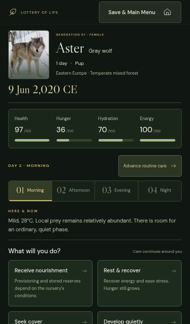
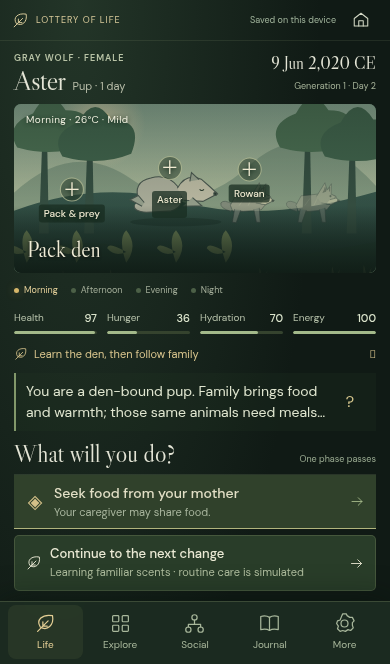
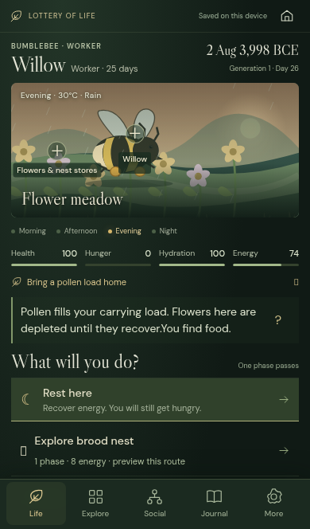
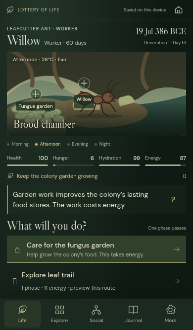

# Phase 3C milestone 3 — Species scenes and connected journeys

Stacked after milestones 1 and 2. This is a scoped implementation, not a Phase 3C completion or release claim. No merge/deployment has occurred.

## What is visible

Original vectors now cover every playable/unlockable species, including bumblebee; active scenes no longer substitute specimen photographs for ten animals. Insect brood, tadpoles, ducklings and selected young mammals visibly differ from mature animals. Locations show flowers, rounded wax cells, fungus/waste, dens, reeds, caches and coastal haul-outs. Carried leaves/pollen and several cover/resource states affect the picture. The illustration is stylized, not an anatomical plate or a fully animated character system.

Suggested journeys enter each species' resource loop using an eligible adjacent leg of the actual saved map. Route previews remain explicit; recommendations never teleport, force actions or alter the random stream. The resource dialog provides nearby paths and explanations. Further actions remain available under More choices; nursery animals retain observation rather than adult abilities.

The ant harvest now fills a finite carried load. Returning to nursery/garden deposits only what the colony can hold. Cultivation and hygiene remain separate jobs. Old version-3 ants acquire a missing zero-valued load without resetting any other field. Existing mastery criteria are shared with a quiet visible progress display; inspecting them awards nothing and death still settles rewards once.

Development pacing includes actual stage/family due dates, calf activities and caregiver/family loss interruptions. Loss is clearly reported rather than buried under a routine summary. A nestling robin's parental meal now builds finite night reserves; the same feeding still requires care. [Biological assumptions](../SPECIES_INDIVIDUALITY.md#phase-3c-referenceparameter-corrections).

## Actual player evidence

These are 390 × 664 local Chromium captures, not physical iPhone tests or hosted previews. The production/development wolf pair imports the same unmodified public version-2 save: Aster, age one day, 9 June 2020, morning, identical 97/36/70/100 condition. The new interface adds an interactive pup scene, clear context and two useful controls above navigation; the production view uses the older notebook interface.

| Existing public Phase 2 | Local Phase 3C milestone 3 |
|---|---|
|  |  |

| Fresh bumblebee carrying pollen | Fresh ant after real worker development |
|---|---|
|  |  |

The fresh bee seed `audit-new-bumblebee` used the ordinary birth UI, three real developmental transitions, flower travel, collection, return and delivery. At age 26 its pollen load was empty after delivery and brood food increased. The fresh ant seed `audit-new-ant` used ordinary care through egg/larva/pupa, a calm encounter, worker garden care, map travel, harvesting, return/delivery and reload. Neither path edits ages, weather, stocks, companions or random values.

All thirteen newborn scenes were captured and inspected. Fox, robin and seal prepared unlock availability only; this is not proof of earning those cards. Other species' captures establish visible openings/early opportunities, not completed signature loops. Existing all-species browser tests additionally prepare adult states to verify real activities and persistence; they must not be described as fresh-life evidence.

## Checks and important failures

Seven game test files contain 166 passing unit cases. Lint/type checking/build pass. Desktop/mobile production-bundle browser coverage includes 62 cases (final run recorded in the PR). Fresh-life cases cover wolf controls/keyboard/locked routes, ant development/carry/delivery, bee development/pollen delivery and optional field-note persistence. Initial browser failures exposed an asynchronous note-toggle assertion and an extra fox choice in its disclosure; both were corrected without removing the actual persistence/action checks.

A broader diagnostic found a serious remaining care failure. [Raw 52-opening sample](evidence/m3-opening-samples.json) uses four fixed 2020 seeds per species and routine care/observed encounters, with no age/condition/weather edits. It is a small deterministic diagnostic, not a population survival estimate or human playtest:

| Species | Reached stated early opportunity | Died beforehand |
|---|---:|---:|
| Bumblebee | 3/4 | 1 predator |
| Ant | 4/4 | 0 |
| Rabbit | 1/4 | 3 starvation |
| Wolf | 1/4 | 3 starvation |
| Elephant | 4/4 | 0 |
| Mallard | 4/4 | 0 |
| Octopus | 3/4 | 1 predator |
| Meerkat | 0/4 | 3 starvation, 1 predator |
| Bullfrog | 4/4 | 0 |
| Raccoon | 0/4 | 3 starvation, 1 dehydration |
| Fox | 0/4 | 4 starvation |
| Robin | 2/4 | 1 starvation, 1 predator |
| Seal | 1/4 | 3 starvation |

Trace evidence shows infant feeding directly depleting nursery food and charging caregivers even on failed feeds, then multiplying care by that depleted nursery food. Caregivers may seek food but return slowly. This must be addressed as a separate care milestone before calling a broad preview candidate ready. Passing tests and new artwork do not negate this finding.

Reproduce with `npm exec --yes --package=tsx@4.21.0 -- tsx scripts/inspect-openings.ts /tmp/lottery-opening-samples.json`. It also verifies structural save round-trips. No dependency, save version, species availability, pack probabilities or economy change is required.

## Remaining gates

The care correction and broader ordinary-UI signature-loop checks remain. So do physical Safari/safe-area checks, child/adult observation, fuller life-story/accessibility review and tuning based on those observations. Fine habitat geometry, full character animation and scientific calibration are not established by these illustrations.

**Implemented:** this scoped scene/journey/carry milestone, subject to listed limitations. **Playable:** pending the approved secure hosted preview and Quentin's iPhone review. **Released:** no. Cloudflare setup, verified GitHub gates and explicit deployment approval remain necessary; no working iPhone URL exists yet.
