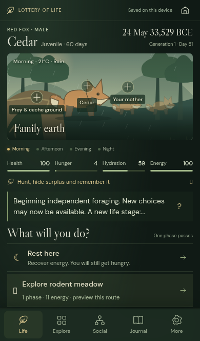
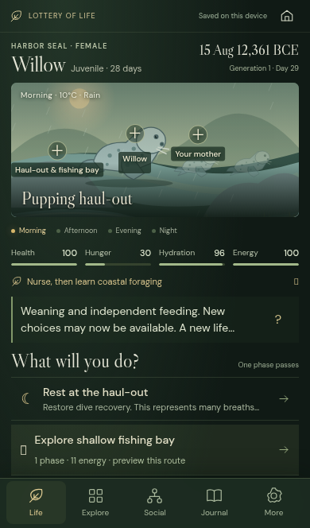

# Phase 3C milestone 4 — Finite care that sustains development

A focused follow-up to milestone 3's unfavorable opening sample. Stacked after PR #6, not merged into develop or main. This is a scoped implementation record, not a claim that all of Phase 3C is complete.

## Problem and correction

In the previous diagnostic, only 27 of 52 fixed openings reached their stated early opportunity. Dependent mammals and nestling birds often starved before independent choices. The trace showed a feedback loop: every request drained the den's food directly and charged a full meal to the caregiver even when feeding failed; feeding success then multiplied by the depleted den food. A parent seeking better food returned only on a rare random movement check.

The shared resolver now distinguishes food supplied by a parent from the young animal's own foraging. Parent condition and the existing care-quality factor represent nutrition/care already available from that individual. A delivered meal spends that caregiver's hunger/energy reserves; a failed request spends a smaller amount of energy. Incidental parental feeding during quiet care also spends reserves, instead of being free. It does not independently remove another serving of plants/prey from the infant's den. The parent still feeds from real local resources, rests, travels, can be injured and can die.

A fed/rested parent returns along one actual graph edge per phase. This does not teleport, bypass connected routes or prevent the parent from first attending to hunger/injury/exhaustion. Missing caregivers no longer generate an unexplained fallback feeding chance. Current-fluid feedback distinguishes an available caregiver from no caregiver being present. The player still cannot nurse an orphan by clicking water.

The existing quantities are bounded game parameters: a successful requested meal uses 9 caregiver hunger and 7 energy; a failed request uses 1 energy; incidental nourishment uses 4 hunger and 3 energy. Ordinary NPC metabolism remains separate. These are not measured milk production, energetic budgets or exact species nursing schedules. The coarse parent role remains a model limitation; this is not a new sex/lactation or complete helper-care simulation. Colony brood and independent feeding keep their existing paths.

No persisted field/version, storage key, paid mechanic, pack probability, reward settlement, family ID or historical date is changed. Existing saves are read without rewriting ages, Coins, unlocks, companions or progression. Continuing an existing save uses the corrected care rules on its next action.

## Same-seed diagnostic comparison

The [before](evidence/m3-opening-samples.json) and [after](evidence/m4-opening-samples.json) reports use the identical script/policy: four fixed 2020 seeds per species, normal phase simulation/routine care to a stated early opportunity, observe non-companion encounters, forty-command limit. Unlock availability alone is prepared for collectible species. Ages, food, conditions, companions and random values are never edited. Structural save round-trips are checked.

| Species | Target age (days) | Reached before | Reached after |
|---|---:|---:|---:|
| Bumblebee | 25 | 3/4 | 3/4 |
| Ant | 60 | 4/4 | 4/4 |
| Rabbit | 28 | 1/4 | 4/4 |
| Wolf | 21 | 1/4 | 4/4 |
| Elephant | 6 | 4/4 | 4/4 |
| Mallard | 1 | 4/4 | 4/4 |
| Octopus | 60 | 3/4 | 3/4 |
| Meerkat | 60 | 0/4 | 3/4 |
| Bullfrog | 5 | 4/4 | 4/4 |
| Raccoon | 70 | 0/4 | 4/4 |
| Fox | 60 | 0/4 | 4/4 |
| Robin | 14 | 2/4 | 3/4 |
| Seal | 28 | 1/4 | 4/4 |

After: **48/52 reached**, four predator deaths. This small deterministic diagnostic does not estimate wild or overall game survival, compare equally difficult targets, certify scientific accuracy, or prove that players enjoy the game. It shows that the traced starvation loop is removed in these openings without making mortality disappear.

Reproduce: `npm exec --yes --package=tsx@4.21.0 -- tsx scripts/inspect-openings.ts /tmp/lottery-opening-samples.json`.

## Ordinary mobile UI evidence

A separate [thirteen-species UI record](evidence/m4-ui-openings.json) uses `audit-new-<species>` and the ordinary historical birth UI at 390 × 664. The ten starters use normal availability; fox/robin/seal prepare unlock availability only. Each animal starts at age zero. Actual care/development commands reached rabbit 28, wolf 21, elephant 6, octopus 60, meerkat 60, bullfrog 5, raccoon 70, fox 60, robin 14 and seal 28 days; insect workers emerged through their actual brood stages. No age/resource/weather/companion edits were made. Main opening controls fit above navigation and no page errors occurred. These observations cover development and emerging choices, not every later signature loop.

| Fox after nursery development | Seal after real weaning |
|---|---|
|  |  |

The bee still completed flowers → pollen → home → brood delivery; the ant still reached work and garden care. The automated fresh wolf browser case now advances to day 21, checks the den-age route lock is removed, previews a real family route without altering availability, and verifies persistence. Inspection is not claimed as a completed trip when an actual caregiver/condition may still block it.

## Checks and remaining work

Unit coverage now includes the traced healthy-care case with a depleted den, failed-request costs, no-caregiver failure, genuine exhausted-ecosystem mortality, parents returning only over adjacent edges, preserved save round-trips and sampled development for the affected species. The successful-meal unit case prepares an RNG value to isolate that rule; it is explicitly not presented as a fresh-life playthrough. Existing currency, pack, mortality, bloodline, migration, narration-equivalence and manual/automatic simulation checks remain.

The PR records actual lint/type/build and unit/browser results. Chromium touch emulation is not iPhone Safari. Further Phase 3C review includes ordinary signature loops across more seeds, the life-story/accessibility pass, coarse NPC/helper roles and aquatic-fluid presentation, touch/Safari behavior, and observation of a child/adult playing. Physical-device observations may require more iteration before a release candidate is ready.

**Implemented:** this finite-care milestone after its checks pass. **Playable:** not yet — Quentin has not personally tested an approved hosted candidate on his iPhone. **Released:** no. Production workflow remains disabled and historical/main/develop refs are unchanged. No Cloudflare project was created, flag enabled or deployment run. The separate preview still needs documented manual GitHub/Cloudflare setup and explicit publication approval.
